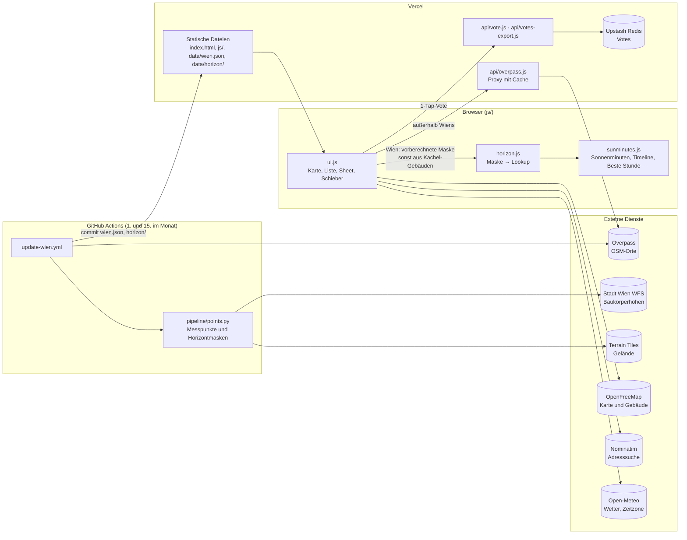

# SunCafe

Zeigt Cafés und Bäckereien in der Nähe und schätzt, ob dort gerade Sonne oder Schatten ist (Gebäudeschatten, Vorschau bis 48 h), inklusive Öffnungszeiten.

Funktioniert weltweit; für Wien liegt ein vorab geladener Datensatz bei, der die Abfrage beschleunigt.

Quellcode: https://github.com/NicoFuchsGIT/SunCafe

## Architektur

Wien wird vorberechnet, weltweit rechnet der Browser selbst, Vercel Functions nur für schlanke APIs (Entscheidung und Begründung: [PRD §9](docs/PRD.md#9-architektur-entscheidung)).



## Aufbau

```
index.html        Gerüst und Einbindung der Bibliotheken
impressum.html, datenschutz.html, cookies.html, nutzungsbedingungen.html   Rechtstexte (DE und EN auf einer Seite), Stile in css/legal.css, verlinkt im Info-Dialog und unter der Liste
css/style.css     Styles
js/ui.js          Einstiegspunkt: Karte, Zustand, Anzeige, Bedienung (ES-Modul)
js/config.js      Einstellungen: Radien, Standardhöhe, Terrassen-Offset, Augenhöhe, Kettenliste, Overpass-Server …
js/geo.js         Geometrie-Hilfen (Abstände, Punkt-in-Polygon, Strahltest), ohne DOM
js/shade.js       Terrassenposition und Schattenrechnung, ohne DOM
js/horizon.js     Horizontmaske pro Messpunkt (180 Sektoren à 2°, uint8) und Schatten-Lookup, ohne DOM
js/sunminutes.js  Sonnenminuten im Zeitfenster (Standard 2 h, 5-min-Schritt), Öffnungszeiten berücksichtigt, ohne DOM
js/hours.js       Ortszeit und Öffnungszeiten, ohne DOM
js/data.js        Datenquellen: Overpass, wien.json, Nominatim, Open-Meteo, Gebäude aus Kartenkacheln
vendor/           selbst gehostete Bibliotheken: MapLibre GL 4.7.1, SunCalc 1.9.0, opening_hours 3.8.0, i18next 21.10.0 (von opening_hours benötigt; mit Lizenzen; Version beim Update auch in package.json ändern)
test/             Tests mit node:test, Start mit `npm ci && npm test` (Node ≥ 18); SunCalc und opening_hours als devDependencies in denselben Versionen wie in index.html
eslint.config.mjs ESLint-Regeln, Prüfung mit `npm run lint` (vorher einmal `npm install`)
api/overpass.js   Vercel-Funktion: fragt Overpass serverseitig (mit Cache), nimmt nur lat/lng/ptype an und baut die Abfrage selbst
api/vote.js       Vercel-Funktion: nimmt anonyme Votes an (POST), validiert, Rate-Limit pro Ort+Gerät (30 min), Gerät (20/h) und IP-Hash (60/h), speichert in Upstash
api/votes-export.js  Vercel-Funktion: CSV-Export aller Votes (GET mit `Authorization: Bearer <VOTES_EXPORT_TOKEN>`), z. B. `curl -H "Authorization: Bearer $TOKEN" https://<domain>/api/votes-export -o votes.csv`; Token in Vercel als VOTES_EXPORT_TOKEN setzen
api/_lib/storage.js  Adapter für Upstash Redis (REST); Variablen UPSTASH_REDIS_REST_URL/_TOKEN (oder KV_REST_API_*) und VOTE_SALT (zufälliger String, für die Hashes) in Vercel setzen
data/wien.json    vorab geladene Cafés/Terrassen im Umkreis von 5 km um den Stephansplatz
data/horizon/     vorberechnete Horizontmasken für Wien, eine Datei pro Kachel
pipeline/         Python-Pipeline für data/horizon (nur Standardbibliothek), Tests mit `pytest pipeline`
.github/workflows/update-wien.yml   aktualisiert data/wien.json und data/horizon am 1. und 15. jedes Monats
.github/workflows/ci.yml            Lint und Tests bei jedem Push und Pull Request
```

## Datenquellen

- Karte: OpenFreeMap (Vektorkacheln, ohne Schlüssel); Gebäude für die Schattenrechnung stammen aus diesen Kacheln
- Cafés und Öffnungszeiten: OpenStreetMap über die Overpass-API (in Wien aus `data/wien.json`)
- Adresssuche und Land/Bundesland für die Feiertage: Nominatim (höchstens 1 Anfrage pro Sekunde, Ergebnis wird lokal gespeichert)
- Wetter und Zeitzone des Orts: Open-Meteo
- Sonnenstand: SunCalc, Öffnungszeiten: opening_hours.js
- Gebäudehöhen Wien: Baukörpermodell der Flächen-Mehrzweckkarte, Stadt Wien Open Government Data (CC BY 4.0)
- Gelände: Terrain Tiles (AWS Open Data), in Österreich aus dem DGM Österreich (CC BY 3.0 AT)

Wie daraus Sonne und Schatten werden: [docs/METHODIK.md](docs/METHODIK.md).

Daten © OpenStreetMap contributors (ODbL).
Datenquelle: Stadt Wien – data.wien.gv.at (CC BY 4.0).
Gelände: © offene Daten Österreichs – Digitales Geländemodell (DGM) Österreich.

## Datenschutz und Recht

Grundsätze, die Texte und Tests (`test/legal.test.mjs`) voraussetzen:

- Keine Cookies, keine Webanalyse, keine eingebetteten Fremdinhalte, Schriften und Bibliotheken selbst gehostet.
- `localStorage` nur in `js/i18n.js` (Sprache, nur nach Auswahl) und `js/vote.js` (Geräte-ID und Sperrzeit, erst beim Senden eines Votes). Alles andere (letzter Ort, Zwischenspeicher) liegt in `sessionStorage`. Neue Einträge: in `cookies.html` ergänzen und prüfen, ob eine Einwilligung nötig wird (§ 165 Abs. 3 TKG 2021).
- Koordinaten gehen nur gerundet raus: Overpass 3 Stellen (~100 m), Wetter und Bundesland 2 Stellen (~1 km).
- Neuer Drittdienst: Host in die CSP (`vercel.json`) **und** in `datenschutz.html` eintragen (der Test prüft das).
- Vor dem Livegang in `impressum.html` und `datenschutz.html` die gelb markierten Platzhalter (Name, Anschrift, E-Mail, Datenbank-Region) ausfüllen; `npm test` zeigt sie als TODO an.

## Hinweise

- Kein Cache-Busting nötig: `vercel.json` liefert `index.html`, `js/`, `css/` und `data/` mit `Cache-Control: max-age=0, must-revalidate` aus. Browser fragen bei jedem Laden per ETag nach und bekommen nur bei Änderungen die neue Datei (sonst `304`). `?v=`-Parameter deshalb nicht mehr anhängen.
- Uhrzeit und Öffnungsstatus richten sich nach der Ortszeit des gewählten Orts, nicht nach der Zeitzone des Browsers.
- Feiertage (`PH` in den Öffnungszeiten) gelten für Land und Bundesland des Orts. Ist das Land nicht ermittelbar, werden solche Öffnungszeiten als unbekannt angezeigt.
- Ketten (Liste `BAD_CHAINS` in `config.js`) werden ausgeblendet, verglichen wird auf ganze Wörter.
- Gebäude ohne Höhenangabe in OpenStreetMap werden pauschal mit 15 m angesetzt (`DEFAULT_HEIGHT` in `config.js`), das Ergebnis ist eine Näherung.